# App flow

**Interactive version** (search, click to focus, pan and zoom): <https://go-dima.github.io/school-schedule-app/>. It is rebuilt from `main` whenever `src/` or the script changes.

How the app is wired, from the router down to Supabase: which page renders which components, which hooks they call, and which services and API namespaces those reach. The chart is built from the real imports under `src/`, so it matches the code at the commit you are reading.

## How to read it

- An arrow from A to B means "A imports B".
- Each layer is one band, top to bottom: **Routing & Layouts → Pages → Components → Elements → Hooks → Contexts → Services → API**. Most arrows point down. An arrow that points up (e.g. a context that uses a hook) or arcs within a band (e.g. a component that uses another component) is an import inside a layer or back up the stack.
- Long bands wrap onto more lines. Inside a band, nodes sit near the nodes they connect to, so arrows stay short.
- In **Pages**, nodes are grouped by page folder (`pages/schedule/`, `pages/pendingApprovals/`, `pages/students/`), so a desktop page, its 📱 mobile page and the UI only that page uses sit together. Each page's controller hook is in **Hooks**, and its pure logic is in **Services**.
- `services/api.ts` is split into its namespaces (`authApi`, `usersApi`, …). A file points at the namespaces it imports, and each namespace points at the `supabase` client and any other module its body uses.

| Color  | Kind                                                                |
| ------ | ------------------------------------------------------------------- |
| Violet | Routing and layouts: `App`, router, guards, `layouts/`              |
| Blue   | Pages                                                               |
| Green  | Components (`components/`), elements (`elements/`) and page-only UI |
| Amber  | Hooks, including page controllers                                   |
| Pink   | Contexts                                                            |
| Orange | Services and pure page logic                                        |
| Cyan   | API namespaces and the `supabase` client                            |

## What is left out

- Tests, stories, `src/stories/`, `src/testUtils/` and type-only imports.
- Leaf helpers: `utils/`, `constants/`, `types/` and `routes/paths.ts`.
- Small helper modules inside `components/` (`textSearchOptions`, `lessonCardModel`, …) are folded into the component that owns them. The owner shows their imports; files that import a helper get no arrow for it.
- Files that are one concept split in two are drawn as one node: `AuthContextObject` is part of `AuthContext`, `resolveGate` is part of `guards`, and `main` is part of `App`.

## Updating the chart

`scripts/gen-app-flow.ts` generates `docs/app-flow.svg` and the import list below. Don't edit either by hand:

```sh
npm run docs:app-flow           # rewrite the chart and the list
npm run docs:app-flow:check     # exit 1 if either is stale
npm run docs:app-flow -- --html /tmp/app-flow.html   # also write an interactive page (search, focus, pan/zoom)
```

The SVG follows your system's light or dark setting. Click it to open it at full size.

To chart a new kind of file, edit the rule lists at the top of the script:

- `CLASSIFY`: ordered path rules that give a file its kind (and color). The first match wins, and a file that matches nothing is left out. The script prints the files it left out, so check that list after adding a folder.
- `MERGE`: files that are part of another file's concept. The owner takes over their imports and importers.
- `ABSORB`: helpers owned by one component. The owner takes over their imports only.
- `LAYERS`: which band each kind is drawn in, top to bottom.

## Chart

<!-- app-flow:start -->
<!-- Generated by scripts/gen-app-flow.ts. Run `npm run docs:app-flow` instead of editing. -->

[](app-flow.svg)

<details>
<summary>The same graph as text: what each module imports</summary>

**Routing & Layouts**

- `App` → `AllChildrenContext`, `AuthContext`, `ChildContext`, `ErrorBoundary`, `UiModeContext`, `router`
- `AppLayout` → `Header`, `Sidebar`
- `ByUiMode` → `UiModeContext`
- `Header` → `ProfileDropdown`, `usePageInfo`
- `MobileAppLayout` → `ProfileDropdown`, `useNavItems`, `usePageInfo`
- `Sidebar` → `useNavItems`
- `guards` → `AuthContext`
- `router` → `AppLayout`, `ByUiMode`, `ClassManagementPage`, `ErrorBoundary`, `LoginPage`, `MobileAppLayout`, `MobilePendingApprovalsPage`, `MobileSchedulePage`, `PendingApprovalPage`, `PendingApprovalsPage`, `ProfileSettingsPage`, `ProfileSetupPage`, `SchedulePage`, `SignupPage`, `SignupVerifyEmailPage`, `StudentsPage`, `UserListPage`, `guards`

**Pages**

- `ClassManagementPage` → `AuthContext`, `ClassEnrollmentDrawer`, `ClassForm`, `EnrollmentCount`, `FilterField`, `FilterSelect`, `FiltersBar`, `GradesRangeTag`, `GroupTrackTags`, `ScopeSelector`, `ScopeTag`, `TextSearch`, `classesApi`, `enrollmentService`, `scheduleService`, `timeSlotsApi`
- `DayAgendaList` → `MobileLessonCard`
- `LoginPage` → `AuthContext`
- `MobilePendingApprovalsPage` → `PendingApprovalCard`, `PendingApprovalSheet`, `usePendingApprovalsController`
- `MobileSchedulePage` → `AuthContext`, `MobileScheduleView`, `ScheduleCatalogContext`, `SchedulePage`, `dayAgenda`, `scheduleCapabilities`, `useChildScheduleController`
- `MobileScheduleView` → `AddChildButton`, `ChildTabs`, `CommittedReadOnlyBanner`, `DraftBanner`, `ScheduleDayView`
- `PendingApprovalCard` → `usePendingApprovalsController`
- `PendingApprovalForm` → `ChildAccountLinkPicker`, `ScopeSelector`
- `PendingApprovalPage` → `AuthContext`
- `PendingApprovalSheet` → `BottomSheet`, `PendingApprovalForm`
- `PendingApprovalsPage` → `PendingApprovalForm`, `usePendingApprovalsController`
- `ProfileSettingsPage` → `AuthContext`, `ChildManagement`, `usersApi`
- `ProfileSetupPage` → `AuthContext`, `usersApi`
- `ScheduleDayView` → `DayAgendaList`, `WeekStrip`, `scheduleDays`, `useSwipe`
- `SchedulePage` → `AddChildButton`, `AuthContext`, `ChildGroupTrackSelector`, `ChildTabs`, `CommittedReadOnlyBanner`, `CreateClassModal`, `DraftBanner`, `FilterField`, `FilterSelect`, `FiltersBar`, `ScheduleCatalogContext`, `ScheduleOverrideModal`, `ScheduleTable`, `ScheduleTabsBar`, `StaffPicker`, `StudentSearchSelector`, `TextSearch`, `UiModeContext`, `classesApi`, `scheduleCapabilities`, `scheduleService`, `scheduleView`, `staffScheduleService`, `timeSlotsApi`, `useChildScheduleController`, `useStaffSchedule`
- `SignupPage` → `AuthContext`, `ToggleRadioGroup`
- `SignupVerifyEmailPage` → nothing charted
- `StudentsPage` → `ChildForm`, `FiltersBar`, `GroupTrackTags`, `ScopeSelector`, `ScopeTag`, `StudentSearchSelector`, `useStudentsController`
- `UserListPage` → `AuthContext`, `UserManagementPage`
- `UserManagementPage` → `AuthContext`, `ChildAccountLinkPicker`, `FiltersBar`, `RoleTagPicker`, `ScopeSelector`, `TextSearch`, `ToggleFilterGroup`, `childrenApi`, `roleRules`, `usersApi`
- `WeekStrip` → nothing charted

**Components**

- `AddChildButton` → `ChildContext`, `ChildForm`
- `BottomSheet` → nothing charted
- `ChildAccountLinkPicker` → `GroupTrackSelect`
- `ChildForm` → `AuthContext`, `GroupTrackSelect`, `ScopeSelector`, `childrenApi`
- `ChildGroupTrackSelector` → `GroupTrackSelect`
- `ChildManagement` → `AuthContext`, `ChildContext`, `ChildForm`, `GroupTrackTags`
- `ChildTabs` → `ScheduleTabsBar`
- `ClassCard` → `ClassCardHeader`, `DoubleLessonTag`, `EnrollmentCount`, `GradesRangeTag`
- `ClassCardHeader` → nothing charted
- `ClassEnrollmentDrawer` → `AddedByTooltip`, `GradesRangeTag`, `GroupTrackTags`, `ScopeTag`, `TeacherPicker`, `TextSearch`, `classesApi`, `scheduleApi`, `scheduleService`, `staffScheduleService`, `useStaffMembers`
- `ClassForm` → `GroupTrackSelect`, `ScopeSelector`, `TeacherPicker`, `TimeSlotOption`, `scheduleService`, `staffScheduleService`, `useStaffMembers`
- `ClassSelectionCard` → `GradesRangeTag`, `TrackTag`, `scheduleService`
- `ClassSelectionDrawer` → `ClassSelectionCard`, `CreateClassButton`, `OverrideSelectionCard`, `scheduleService`
- `CreateClassButton` → nothing charted
- `CreateClassModal` → `ClassForm`
- `ErrorBoundary` → nothing charted
- `FilterField` → nothing charted
- `FilterSelect` → `FilterField`
- `FiltersBar` → nothing charted
- `GroupTrackSelect` → nothing charted
- `GroupTrackTags` → nothing charted
- `MobileLessonCard` → nothing charted
- `OverrideCard` → `ClassCardHeader`, `OverrideSuffixButton`
- `OverrideSelectionCard` → nothing charted
- `PrintableClassRoster` → nothing charted
- `PrintableSchedule` → `scheduleService`
- `ProfileDropdown` → `AuthContext`, `UiModeContext`
- `RoleTagPicker` → nothing charted
- `ScheduleOverrideForm` → `ScopeSelector`, `TeacherPicker`, `TimeSlotOption`, `staffScheduleService`, `useStaffMembers`
- `ScheduleOverrideModal` → `ScheduleOverrideForm`
- `ScheduleTable` → `ClassCard`, `ClassSelectionDrawer`, `OverrideCard`, `OverrideSuffixButton`, `enrollmentService`, `scheduleService`
- `ScheduleTabsBar` → nothing charted
- `ScopeSelector` → `ScopeTag`, `ToggleFilterGroup`
- `ScopeTag` → nothing charted
- `StaffPicker` → `TextSearch`, `staffScheduleService`
- `StudentSearchSelector` → `AllChildrenContext`, `AuthContext`, `ChildForm`, `TextSearch`
- `TeacherPicker` → `TextSearch`
- `TextSearch` → `TextSearchSheet`, `usePickSearch`
- `TextSearchSheet` → `BottomSheet`, `usePickSearch`
- `TimeSlotOption` → `scheduleService`
- `ToggleFilterGroup` → nothing charted
- `ToggleRadioGroup` → nothing charted

**Elements**

- `AddedByTooltip` → nothing charted
- `CommittedReadOnlyBanner` → nothing charted
- `DoubleLessonTag` → nothing charted
- `DraftBanner` → nothing charted
- `EnrollmentCount` → nothing charted
- `GradesRangeTag` → nothing charted
- `OverrideSuffixButton` → nothing charted
- `TrackTag` → nothing charted

**Hooks**

- `useAllChildren` → `AuthContext`, `childrenApi`
- `useAuth` → `authApi`, `permissions`, `roleFlags`, `usersApi`
- `useChildScheduleController` → `AllChildrenContext`, `AuthContext`, `ChildContext`, `groupMandatoryLockService`, `scheduleService`, `trackSelectionService`, `useDraftSelectionAwareness`, `useScheduleCatalog`, `useScheduleOverrides`, `useSelectedSchedule`
- `useChildren` → `AuthContext`, `childrenApi`
- `useDraftSelectionAwareness` → `scheduleApi`
- `useNavItems` → `AuthContext`, `usePendingApprovals`
- `usePageInfo` → nothing charted
- `usePendingApprovals` → `AuthContext`, `usersApi`
- `usePendingApprovalsController` → `AuthContext`, `childrenApi`, `usersApi`
- `usePickSearch` → nothing charted
- `useScheduleCatalog` → `ScheduleCatalogContext`
- `useScheduleOverrides` → `scheduleOverridesApi`
- `useSelectedSchedule` → `scheduleApi`
- `useStaffMembers` → `staffScheduleService`
- `useStaffSchedule` → `staffScheduleService`
- `useStudentsController` → `AllChildrenContext`, `AuthContext`, `childrenApi`
- `useSwipe` → nothing charted

**Contexts**

- `AllChildrenContext` → `useAllChildren`
- `AuthContext` → `useAuth`
- `ChildContext` → `AuthContext`, `useChildren`
- `ScheduleCatalogContext` → `AuthContext`, `classesApi`, `scheduleService`, `timeSlotsApi`
- `UiModeContext` → `uiMode`

**Services**

- `dayAgenda` → `scheduleService`
- `enrollmentService` → `enrollmentApi`
- `groupMandatoryLockService` → `scheduleApi`
- `notificationService` → nothing charted
- `permissions` → `roleFlags`
- `requestedRole` → nothing charted
- `roleFlags` → nothing charted
- `roleRules` → nothing charted
- `scheduleCapabilities` → nothing charted
- `scheduleDays` → nothing charted
- `scheduleService` → nothing charted
- `scheduleView` → nothing charted
- `staffScheduleService` → `classesApi`, `scheduleApi`, `scheduleOverridesApi`, `scheduleService`, `staffApi`
- `trackSelectionService` → `classesApi`, `scheduleApi`
- `uiMode` → nothing charted

**API**

- `authApi` → `requestedRole`, `supabase`
- `childrenApi` → `supabase`
- `classesApi` → `scheduleService`, `supabase`
- `enrollmentApi` → `supabase`
- `scheduleApi` → `supabase`
- `scheduleOverridesApi` → `supabase`
- `staffApi` → `supabase`
- `supabase` → `requestedRole`
- `timeSlotsApi` → `supabase`
- `usersApi` → `notificationService`, `supabase`

</details>

<!-- app-flow:end -->
